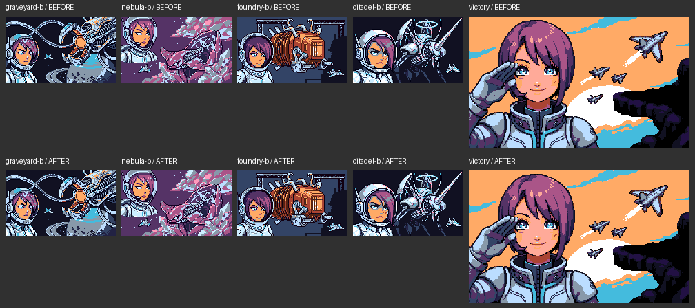
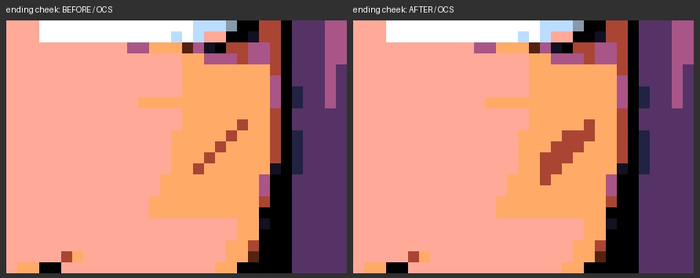

# Bold cheek marks — approved and integrated

Offline child of the five immediate `story-character/*.png` parents. The user
approved the ending close-up and authorized Phase2 integration. Both runtime
importer and independent PNG oracle now default to `layer='bold-marks'`, with
explicit historical `story-character` and `story-eyes` selections. Cost: **$0**.

Copper ink 13 (`#A43`, expanded RGB `#AA4433`), same viewer-right cheek, crisp
four-connected diagonals with single-pixel tips. Ending center is three pixels
wide; ordinary marks remain compact at their original 160×96 resolution.
There is no antialiasing, image resizing, palette modification or paid generation.

| Portrait | Image size | Parent mark | Candidate mark | Changed RGB / OCS pixels |
|---|---|---:|---:|---:|
| Graveyard | 160×96 | 2 | 4 | 2 / 2 |
| Nebula | 160×96 | 3 | 5 | 2 / 2 |
| Foundry | 160×96 | 2 | 4 | 2 / 2 |
| Citadel | 160×96 | 3 | 5 | 2 / 2 |
| Ending | 320×192 | 5 | 13 | 8 / 8 |

## Review gallery

Before is above after in the full native-resolution five-panel sheet. These are
offline previews quantized with the existing `displayed()` helper to actual OCS
scene palettes (including WIN peach skin), **not new emulator captures**.



[Larger five-panel sheet](previews/five-panels-ocs-2x.png)

Individual face reviews, before left / after right, nearest-neighbor enlargement:

- [Graveyard](previews/graveyard-b-before-after.png)
- [Nebula](previews/nebula-b-before-after.png)
- [Foundry](previews/foundry-b-before-after.png)
- [Citadel](previews/citadel-b-before-after.png)
- [Ending face](previews/victory-before-after.png)



Visual inspection: each thicker mark remains separated from the nose, eye and
hair; the ending reads as a tapered diagonal on the cheek. The approved image
bytes are identical to Phase1.

### Native integration review

[Five native portraits: parent / A500 / AROS](../../../../build/story-bold-marks-campaign/bold-marks-native-review.png)
· [Native ending](../../../../build/story-bold-marks-campaign/a500/scene12.screen.png)
· [Evidence JSON](../../../../build/story-bold-marks-campaign/bold-marks-integration-evidence.json)

Both profiles pass all13 scenes, ending input/lifecycle checks and1,160,320
source-derived pixels each.32 complete capture pairs are byte-identical;
64 complete-screen comparisons against the previous character captures contain
only two added pixels per ordinary portrait or eight per ending, with zero
returned-title changes. Full-eye regions and505 ending skin samples are unchanged.
The native gallery and production F9 ending were visually inspected.

## Reproduction and evidence

```sh
python3 tools/make-story-bold-marks.py --check
python3 tools/verify-story-bold-marks.py
python3 tools/make-story-character.py --check
python3 tools/verify-story-character.py
python3 tools/verify-story-bold-marks-native.py game/build/story-bold-marks-campaign
```

The generator refuses differing overwrites. `provenance.json` records parent and
generator SHA256 hashes, exact per-pixel before/after values, displayed-change
counts and output hashes. `protected-sha256.json` freezes259 selected-art/parent
files and the palette. The child directory is excluded from that snapshot.
The authorized one-time `--phase2-metadata` migration preserved the original266-file
Phase1 manifest/provenance under `phase1-evidence/`, verified every old hash before
editing integration code, and removed only the seven code/generated-data/top-level
documentation entries. Every approved image, RGB export, mask and preview byte
was retained. Ordinary generation still refuses differing overwrites.

Each image has a lossless PNG, RGB hex export, OCS preview, full-footprint mask
and additions-only mask. Checks retain every old mark pixel, validate connected
tapered shapes, compare every outside-footprint pixel, preserve all **2,571**
complete-eye-region pixels and explicit nose regions, and preserve the original
**498 peach skin samples + 7 approved additions**, including their displayed color.

Host validation:121 Python tests, C rules, generator freshness and native build
PASS. Production F9 on both profiles also passes skin/sky/title restoration with
seven identical capture pairs. Production probe/timing flags are OFF. Executable
505,972 bytes; presentation data59,676 resident bytes. Campaign performance is
still blocked (A50015 drops/125% peak; AROS11/122%); F9 zero drops,92%/90% peaks.
Full results and reproduction commands: [parent documentation](../../../../../docs/selected-rd-story-images.md).
